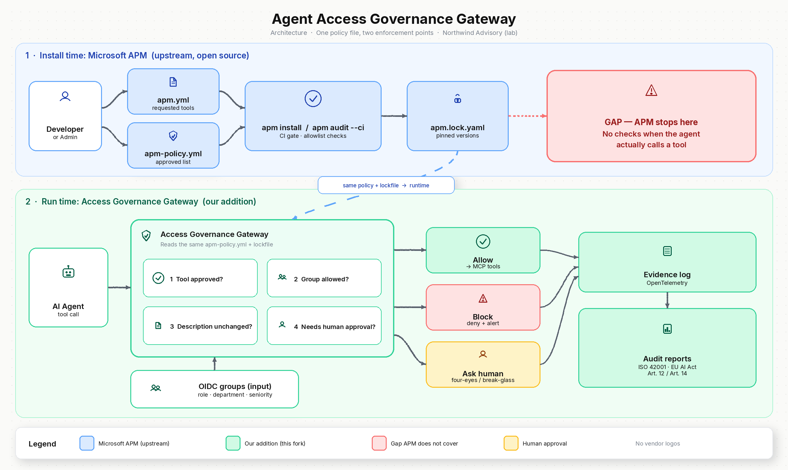

# Agent Access Governance Gateway

A fork of [microsoft/apm](https://github.com/microsoft/apm) that adds a **runtime
Access Governance Gateway** on top of APM's install-time governance. **One policy,
two enforcement points:** the same `apm-policy.yml` + `apm.lock.yaml` that gate
`apm install` / `apm audit --ci` are re-read by a runtime Policy Enforcement
Point that decides **every MCP `tools/call`**.

> Portfolio / lab project. Synthetic data only; fictional firm **Northwind
> Advisory**. Upstream is **Apache-2.0** (software) + **CC-BY-4.0** (docs), with
> historical MIT releases noted in [`NOTICE`](NOTICE). See
> [`docs/DESIGN.md`](docs/DESIGN.md) for the full design.

## Problem

APM governs *what gets installed*; it is explicitly **not a runtime sandbox** and
has no schema for the calling agent's identity. So after a tool is approved and
installed, nothing checks *who* calls it, whether its description changed, or
whether a sensitive call needs a human. This fork adds that runtime layer without
touching upstream APM code.

## Architecture



```
  apm.yml ──install──▶ apm.lock.yaml ──apm audit --ci──▶ CI gate     (UPSTREAM, unchanged)
  apm-policy.yml  ─────────────── same policy, read-only ───────────────┐
                                                                        ▼
  AI agent ──MCP tools/call──▶  GATEWAY (PEP)  ──▶ MCP server          (THIS FORK)
                                 1 tool approved? (allowlist, deny wins)
      OIDC (Keycloak) ────────▶  2 group allowed? (OPA: role/dept/seniority)
                                 3 description unchanged? (SHA-256 pin)
                                 4 approval tier? allow|ask|deny|four-eyes|break-glass
                                        │                     │
                                        ▼                     ▼
                              OTel evidence log      approval CLI (grants)
                                        │
                                        ▼
                       reports: inventory · access · blocked · approvals · audit summary (MD + PDF)
```

Four checks must all pass to auto-allow; the gateway **fails closed** if policy,
lockfile, or OPA cannot be loaded.

## How to run

```bash
# Offline demo (no Docker): run the 10-minute Northwind scenario, write evidence,
# render Markdown reports. PDF needs the optional extra: pip install '.[reports]'.
make demo

# Reports (Markdown + PDF) from a demo/eval run's evidence
make reports

# Eval harness (measured metrics). Offline reference PDP:
make eval
# Authoritative, OPA-backed run (needs OPA 1.22.3):
make eval-opa

# Full lab: OPA + Keycloak + OTel collector + gateway
docker compose -f demo/docker-compose.yml up

# Tests (offline; OPA-backed tests skip cleanly without the opa binary)
make gateway-test
```

## Results

| Metric | Value |
|---|---|
| Block rate (attack suite) | *planned — to be measured* |
| Benign false-block rate (golden path) | *planned — to be measured* |
| Gateway overhead p50 / p95 (allow path) | *planned — to be measured* |

Numbers are published **only** from a committed eval-harness run
(`eval/results/*.json`, stamped with timestamp + git SHA) — never hand-entered.
Run `make eval-opa` to produce the authoritative file, then fill this table from
it.

## Limitations

- Lab/portfolio design: synthetic MCP servers and data; not a production product.
- Does not classify *what code* an agent writes (separate compliance track).
- Does not fix upstream APM preview semantics, `mcp.trust_transitive` wiring, or
  signed install attestations.
- Heuristic description lint is narrow; a clean description with malicious
  server-side behaviour still needs runtime monitoring + human review.
- Single gateway is a deliberate PEP and a single point of failure; HA is out of
  scope for v1.
- Keycloak is the default IdP; Entra is an optional adapter stub, not required.
- The **Audit Summary** maps controls to ISO/IEC 42001 Annex A themes and EU AI
  Act Art. 12 / 14 **illustratively** — not a conformity claim.

## License

This fork follows upstream: **Apache-2.0** for software
([`LICENSE`](LICENSE)), **CC-BY-4.0** for general documentation
([`LICENSE-DOCS`](LICENSE-DOCS)); previously published MIT releases remain under
their original terms, retained in [`NOTICE`](NOTICE). Upstream copyright and
notices are preserved in all substantial portions.
