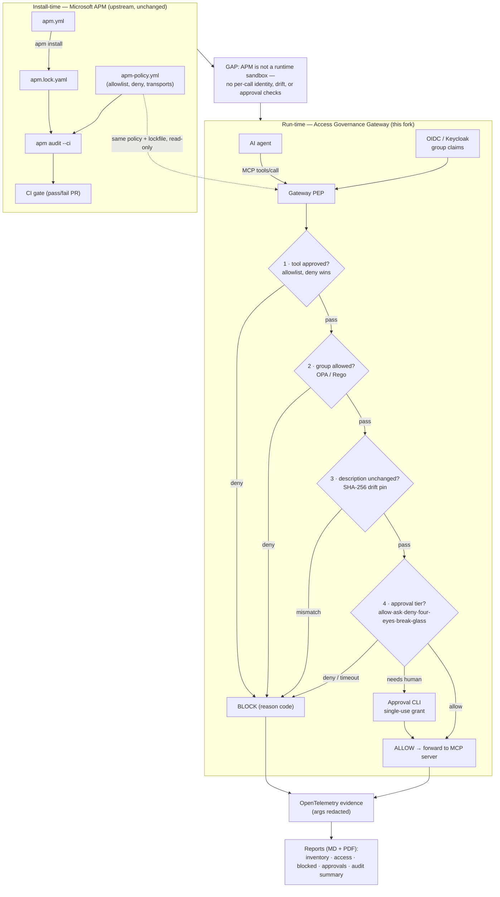

# Agent Access Governance Gateway

A fork of [microsoft/apm](https://github.com/microsoft/apm) that adds a **runtime
Access Governance Gateway** on top of APM's install-time governance. **One policy,
two enforcement points:** the same `apm-policy.yml` + `apm.lock.yaml` that gate
`apm install` / `apm audit --ci` are re-read by a runtime Policy Enforcement
Point that decides **every MCP `tools/call`**.

> Portfolio / lab project. Synthetic data only; fictional firm **Northwind
> Advisory**. Built on and crediting [microsoft/apm](https://github.com/microsoft/apm)
> (**Apache-2.0** software · **CC-BY-4.0** docs; historical MIT in [`NOTICE`](NOTICE)).
> The upstream APM README is preserved at
> [`docs/UPSTREAM-README.md`](docs/UPSTREAM-README.md). Full design:
> [`docs/DESIGN.md`](docs/DESIGN.md).

## Problem

APM governs *what gets installed*; it is explicitly **not a runtime sandbox** and
has no schema for the calling agent's identity. So after a tool is approved and
installed, nothing checks *who* calls it, whether its description changed, or
whether a sensitive call needs a human. This fork adds that runtime layer without
touching upstream APM code (`src/apm_cli/**` is imported read-only).

## APM (upstream) vs this fork

| Capability | APM (upstream) | This fork |
|---|---|---|
| Install-time dependency/MCP allowlist (`apm-policy.yml`) | ✅ | ✅ (unchanged, reused) |
| CI gate (`apm audit --ci`) | ✅ | ✅ (run in fork CI) |
| **Runtime per-call enforcement** of `tools/call` | ❌ (not a runtime sandbox) | ✅ Policy Enforcement Point |
| **OIDC group claims** (per-call caller identity) | ❌ (no identity in schema) | ✅ via OPA — group matching (Keycloak default) |
| **Live tool-description drift** detection | ❌ (install-time file hashes only) | ✅ SHA-256 pin per approved tool |
| **Approval tiers** `allow`/`ask`/`deny` | ❌ | ✅ |
| **Four-eyes** (two distinct approvers) | ❌ | ✅ sequential or one-shot |
| **Break-glass** (justified emergency) | ❌ | ✅ flagged high-severity |
| **Evidence** per decision | lockfile + SARIF | ✅ OpenTelemetry span (args redacted) |
| **Auditor reports** (MD + PDF) | ❌ | ✅ 5 reports, derived from evidence |

## Architecture

The top lane is upstream APM (install-time); the gap is what it does **not** do;
the bottom lane is this fork's runtime gateway. All four checks must pass to
auto-allow, and the gateway **fails closed** if policy, lockfile, or OPA cannot
be loaded.



## How to run

```bash
# Offline demo (no Docker): run the 10-minute Northwind scenario, write evidence,
# render Markdown reports. PDF needs the optional extra: pip install '.[reports]'.
make demo

# Reports (Markdown + PDF) from a demo/eval run's evidence
make reports

# Eval harness (measured metrics). Offline reference PDP:
make eval
# Authoritative, OPA-backed run (needs OPA 1.22.3):
make eval-opa

# Full lab: OPA + Keycloak + OTel collector + gateway
docker compose -f demo/docker-compose.yml up

# Tests (offline; OPA-backed tests skip cleanly without the opa binary)
make gateway-test
```

## Results

Numbers are published **only** from the committed, OPA-backed eval run
(`eval/results/latest-opa.json`, stamped with timestamp + git SHA) — never
hand-entered. The table below is rendered from that file by
`python scripts/render_results_table.py`; run `make eval-opa` to produce the
file, then `make results-table` to refresh this section.

<!-- RESULTS:BEGIN -->
*No committed `eval/results/latest-opa.json` yet — run `make eval-opa` then
`make results-table`. Until then: planned / to be measured.*
<!-- RESULTS:END -->

## Limitations

- Lab/portfolio design: synthetic MCP servers and data; not a production product.
- Does not classify *what code* an agent writes (separate compliance track).
- Does not fix upstream APM preview semantics, `mcp.trust_transitive` wiring, or
  signed install attestations.
- Heuristic description lint is narrow; a clean description with malicious
  server-side behaviour still needs runtime monitoring + human review.
- Single gateway is a deliberate PEP and a single point of failure; HA is out of
  scope for v1.
- Keycloak is the default IdP; Entra is an optional adapter stub, not required.
- Check 2 currently matches on OIDC **group** claims. The token also carries
  `role` / `department` / `seniority`, but mapping access to those finer claims
  in Rego is **future work**.
- The **Audit Summary** maps controls to ISO/IEC 42001 Annex A themes and EU AI
  Act Art. 12 / 14 **illustratively** — not a conformity claim.

## Credit & license

Built on [microsoft/apm](https://github.com/microsoft/apm) — all upstream APM
behaviour, docs, and the preserved [`docs/UPSTREAM-README.md`](docs/UPSTREAM-README.md)
are Microsoft's work. This fork follows upstream licensing: **Apache-2.0** for
software ([`LICENSE`](LICENSE)), **CC-BY-4.0** for general documentation
([`LICENSE-DOCS`](LICENSE-DOCS)); previously published MIT releases remain under
their original terms, retained in [`NOTICE`](NOTICE). Upstream copyright and
notices are preserved in all substantial portions.
