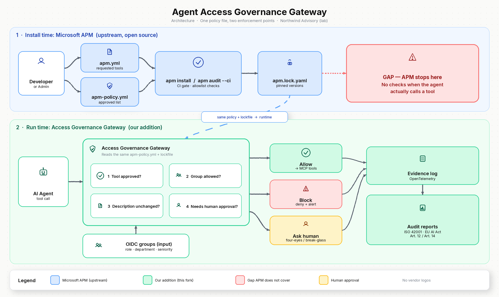

# Agent Access Governance Gateway

**Design note (v0.1)** · Portfolio project by Mir Mansoor Ahmed  
**Status:** design · fictional firm in examples: *Northwind Advisory*  
**Upstream:** fork of [microsoft/apm](https://github.com/microsoft/apm) (MIT) · this document describes the fork’s intended additions only

---

## 1. Problem

Consulting and product teams already run coding agents and MCP-connected agents against client and internal systems. A consultant at Northwind Advisory must not use a new MCP server, plugin or skill until security has approved it. After approval, access must follow group membership (role, department, seniority), and every install decision and every live tool call must leave a visible trail that an auditor can read. Install-time package governance alone does not cover what the agent does after the package lands on disk.

---

## 2. What upstream APM already does

Credited to [microsoft/apm](https://github.com/microsoft/apm) and its docs ([Governance deep-dive](https://microsoft.github.io/apm/enterprise/governance-guide/), [Policy files](https://microsoft.github.io/apm/enterprise/apm-policy/), [apm audit](https://microsoft.github.io/apm/reference/cli/audit/)):

| Piece | Role |
|---|---|
| `apm.yml` | Project manifest: agent packages, skills, plugins, MCP servers |
| `apm.lock.yaml` | Lockfile: resolved sources, commit pins, content hashes |
| `apm-policy.yml` | Org policy: `dependencies.allow`/`deny`, `mcp.allow`/`deny`, transport rules, inheritance |
| `apm install` | Install-time policy gate (deps + direct MCP + transitive MCP preflight) |
| `apm audit --ci [--policy]` | CI gate: 8 baseline lockfile checks + up to 21 policy checks; SARIF for Code Scanning |
| Content scan | Hidden-Unicode scan on deployed primitives |
| Inheritance | Tighten-only merge enterprise → org → repo |

APM’s own framing: *“`apm-policy.yml` governs what gets installed; your agent harness governs what runs. The two planes do not overlap.”* And: *“APM is an install-time gate, not a runtime sandbox.”* Policy enforcement via `apm install` / `apm audit --ci --policy` is documented as **early preview**; pin an APM version before treating it as a production gate.

---

## 3. APM gaps this fork targets

Each gap below is checked against APM’s published docs. Items we could not confirm in docs/issues are marked **unverified**.

| Gap | Evidence | Status |
|---|---|---|
| **No runtime enforcement** of tool calls | Governance guide: `apm compile` / `apm run` enforce zero policy; “install-time gate, not a runtime sandbox.” Policy files page: schema “has no fields for runtime permissions or agent sandboxing.” | **Verified** |
| **No per-call caller identity / group checks** | Policy matches MCP/dependency *names* and transports; no schema fields for OIDC groups, role, department or seniority of the calling agent. | **Verified** (absence in schema) |
| **No live tool-catalogue drift block** | Audit drift / `content-integrity` re-hashes *deployed files* vs the lockfile. Docs explicitly do not guarantee “anything about runtime behavior.” Live `tools/list` description change after install is outside APM’s plane. | **Verified** (install/audit-file drift ≠ runtime catalogue pin) |
| **No runtime human-approval tiers** | Policy change uses git PR + CODEOWNERS (process control). No `allow` / `ask` / `deny` / four-eyes / break-glass on individual tool *calls*. | **Verified** (absence); PR-based policy change remains valuable and is kept |
| **No auditor-facing compliance report pack** | Evidence today: `apm.lock.yaml` git history + SARIF → Code Scanning (and customer SIEM export). No first-party ISO 42001 Annex A / EU AI Act Art. 12/14 mapped PDF pack. | **Verified** as what ships; mapped reports are **our addition** |
| Signed SLSA/sigstore attestation that the gate ran | Listed by APM as a known gap (§14). | **Verified** upstream gap; **out of scope** for this fork’s first cut |
| `mcp.trust_transitive` field parsed but not enforced | Governance guide §14. | **Verified** upstream gap; fork does not claim to fix the field wiring |

---

## 4. Our additions (one policy, two enforcement points)

The fork keeps upstream APM intact for install and CI. It adds a **runtime access-governance gateway** that loads the **same** `apm-policy.yml` (and lockfile pins) so policy is written once and enforced twice.

1. **Runtime PEP** — every MCP `tools/call` passes the gateway; unapproved servers/tools are denied even if something bypassed install.
2. **Same policy source** — gateway reads effective `apm-policy.yml` + lockfile; CI still runs `apm audit --ci --policy`.
3. **OIDC group checks (OPA)** — claims for role, department and seniority; Rego maps groups to allowed MCP/tool sets (Keycloak in the lab; Entra only as an optional adapter).
4. **Description drift pin** — SHA-256 of approved tool name + description + input schema; mismatch → block until pin reset.
5. **Approval tiers** — `allow` · `ask` · `deny` · `four-eyes` · `break-glass` on sensitive calls.
6. **Onboarding workflow** — request → linter + attack suite → four-eyes approval → PR that updates `apm-policy.yml`.
7. **Evidence** — OpenTelemetry spans per decision; report generators for inventory, access, blocks, approvals and a cautious audit summary.

**Cloud-agnostic core:** OPA, OpenTelemetry, OIDC (Keycloak default), MCP. No vendor lock-in to a single cloud identity or SIEM.

---

## 5. Comparison — upstream APM vs this fork

| Capability | Upstream APM | This fork |
|---|---|---|
| Manifest + lockfile (`apm.yml`, `apm.lock.yaml`) | Yes | Yes (unchanged) |
| Org policy (`apm-policy.yml`, tighten-only inheritance) | Yes | Yes (unchanged; single source of truth) |
| Install gate (`apm install`) | Yes | Yes |
| CI gate (`apm audit --ci`) | Yes | Yes |
| Runtime per-call enforcement | No | **Added** |
| OIDC group / role / dept / seniority checks | No | **Added** (OPA) |
| Live tool-description drift pin | No (file drift at audit only) | **Added** |
| Runtime approval tiers + onboarding flow | Policy PR only | **Added** (plus keep PR flow) |
| OTel decision log + mapped auditor reports | Lockfile + SARIF | **Added** reports on top of upstream trails |

---

## 6. Architecture

*Miro-style board (v2). Also: [`architecture-v2.svg`](architecture-v2.svg), [`architecture-v2.drawio`](architecture-v2.drawio). Earlier flat version kept as [`architecture.png`](architecture.png).*

**How to read it:** the top lane is **Microsoft APM** — developer requests tools in `apm.yml`, security keeps the approved list in `apm-policy.yml`, CI runs `apm install` / `apm audit --ci`, and the lockfile pins what was installed. APM **stops there**: it does not check a live tool call. The bottom lane is **our addition** — the Access Governance Gateway sits between the AI agent and MCP tools, re-reads the **same** policy and lockfile, checks OIDC groups (role, department, seniority), description drift and human-approval tiers, then writes an OpenTelemetry evidence log and audit reports.

---

## 7. Reports produced

| Report | Contents |
|---|---|
| **Tool Inventory** | Approved MCP servers / packages, approver, policy version, lockfile pin |
| **Access by Group** | Which OIDC groups may call which tools |
| **Blocked Activity** | Denied calls with reason (policy miss, group miss, drift, approval denied) |
| **Approvals** | Ask / four-eyes / break-glass grants and rejections |
| **Audit Summary** | Cautious mapping of controls to **ISO/IEC 42001 Annex A** themes and **EU AI Act Art. 12** (logging) / **Art. 14** (human oversight). Mapping is illustrative for a lab demo — not a conformity claim and not a substitute for Legal / accredited audit |

Upstream SARIF and lockfile history remain first-class; reports complement them, they do not replace them.

---

## 8. Ten-minute demo (Northwind Advisory)

1. **Unapproved MCP** — developer adds a non-allowlisted server to `apm.yml`; `apm audit --ci` fails the PR.  
2. **Onboard** — request → automated linter + attack suite → four-eyes → PR merges an allow entry into `apm-policy.yml`.  
3. **Runtime allow** — agent in the approved group calls the tool; gateway allows; OTel span shows `allow`.  
4. **Drift** — tool description changes after approval; gateway blocks on pin mismatch.  
5. **Wrong group** — agent lacking the required seniority/department claim is denied; **Audit Summary** shows inventory, blocks and approvals.

---

## 9. Success metrics *(planned — no numbers claimed yet)*

- Block rate on unapproved MCP installs in CI (`apm audit --ci`).  
- Block rate on runtime calls that violate policy, group rules or description pins.  
- Benign false-block rate on an approved golden path.  
- Gateway overhead (p50 / p95) on allow path.  
- Share of sensitive calls that received a recorded human decision.  
- Time from tool request to policy PR merge (onboarding SLA).

All figures will be measured in-repo with a scripted eval and published with method limitations; nothing is claimed until then.

---

## 10. Limits and out of scope

- Lab / portfolio design: synthetic MCP servers and synthetic data; not a production product.  
- Does not classify *what code* a coding agent writes (e.g. prohibited product features); that is a separate compliance-checker track.  
- Does not fix upstream APM preview semantics, `mcp.trust_transitive` field wiring, or signed install attestations.  
- Heuristic description lint is narrow; a clean description with malicious server-side behaviour still needs runtime monitoring and human review.  
- Single gateway is a deliberate PEP and also a single point of failure; HA is out of scope for v1.  
- Entra / cloud IdP modules are optional adapters; the default demo uses Keycloak.  
- No Microsoft-customer, Telekom or other employer branding on demos.

---

## Fork hygiene and license

Upstream [microsoft/apm](https://github.com/microsoft/apm) is **MIT** (Copyright (c) Microsoft Corporation). This fork will:

1. Keep the upstream MIT copyright and license notice in all substantial portions.  
2. Track `upstream/main` with periodic merges; pin the forked APM CLI version in CI.  
3. Isolate fork-only code under clear paths (e.g. `gateway/`, `policies/runtime/`, `reports/`) so upstream merges stay reviewable.  
4. Document fork additions in this `DESIGN.md` and the README; do not present upstream behaviour as our invention.  
5. Prefer contributing fixes for pure upstream bugs upstream rather than carrying silent divergence.

---

*Sources consulted for APM facts: microsoft/apm README; Governance deep-dive (incl. §§2, 4, 5, 8, 14); Policy files page; apm audit CLI reference; LICENSE (MIT). Design date: 9 Nov 2026 (Europe/Berlin).*
